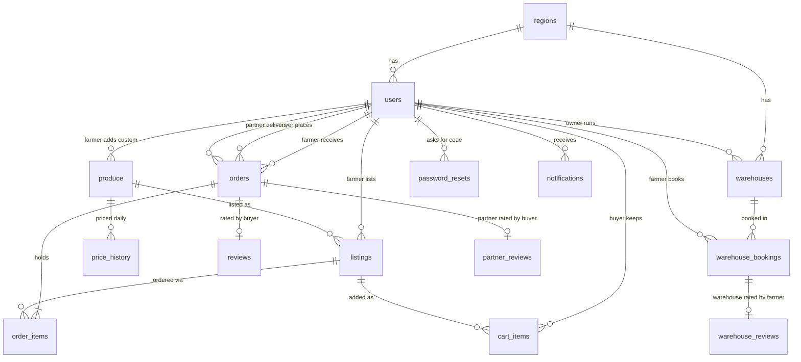

# AgriChain: Database

PostgreSQL 18. Raw SQL through the `pg` package, **no ORM**. The schema is changed only through numbered migration files. Back to the [main document](AgriChain-Main.md).

## 1. Overview

| Item | Value |
|---|---|
| Development database | `ft_db` |
| Test database | `ft_db_test` (wiped and re-seeded on every `npm test`) |
| Connection | `DATABASE_URL` / `TEST_DATABASE_URL` in `backendft/.env` |
| Migrations | `backendft/src/db/migrations/*.sql`, applied in filename order by `src/db/migrator.js` |
| Migration record | table `schema_migrations (name, applied_at)`; each file runs in its own transaction |
| Number types | the `pg` type parser converts `NUMERIC` and `INT8` to JavaScript numbers |

Commands (run in `backendft`):

| Command | Effect |
|---|---|
| `npm run db:migrate` | Apply new migration files |
| `npm run db:seed` | Idempotent demo data (regions, produce, users, sample listings, a warehouse) |
| `npm run db:reset -- --yes` | **Drops every table**, then migrates and seeds. Never run on data the user wants to keep |
| `npm run prices:fetch` | Fetch today's market prices now |

### What a migration is (plain words)

The database is like a set of spreadsheets (tables). A **migration** is a small numbered SQL file that changes the **structure**: add a table, add a column, change a rule. `npm run db:migrate` runs, in order, only the files the database has not had yet, and records each one in `schema_migrations`. Running it twice does nothing the second time, and it never deletes data.

| Change | Needs a migration? | Example |
|---|---|---|
| Structure (table, column, constraint) | **Yes**, a new file | Adding the `notifications` table = migration 009 |
| Data (rows) | **No**, the app does it while running | A new farmer signs up, an order is placed |

**When to run it**
- After you (or a friend) pull code that contains a new migration file.
- On a fresh setup (new laptop, new database) to build all the tables.
- If nothing is new, it does nothing, so it is always safe to run.

**Sharing the project:** only the structure travels with the code, so every copy has the same tables and the code works everywhere. The data does not travel: each database keeps its own users, orders and listings. `npm run db:seed` is the one command that adds data (demo accounts and sample produce), as a convenience for a fresh setup.

**Rule:** never edit a migration that has already been applied. Your database will not run it again, so the change would never reach it. Add a new file instead (the next one is `010_...sql`).

## 2. Entity relationships

## 3. Tables

### regions
| Column | Type | Notes |
|---|---|---|
| id | SERIAL PK | |
| name | TEXT NOT NULL UNIQUE | Seeded: Erumely, Kanjirapally |

### users
| Column | Type | Notes |
|---|---|---|
| id | SERIAL PK | |
| name | TEXT NOT NULL | |
| phone | TEXT NOT NULL UNIQUE | Login identifier |
| password_hash | TEXT | bcrypt hash |
| role | TEXT NOT NULL | `FARMER`, `BUYER`, `WAREHOUSE_OWNER`, `DELIVERY_PARTNER` |
| base_location | TEXT | Default delivery address for buyers; pickup place for farmers |
| region_id | INTEGER NOT NULL → regions | Everything is matched by region |
| created_at | TIMESTAMP NOT NULL | |

### produce
| Column | Type | Notes |
|---|---|---|
| id | SERIAL PK | |
| name | TEXT NOT NULL UNIQUE | Uses the market price site's names (e.g. `Onion Big`, `French Beans`) |
| category | TEXT NOT NULL | `VEGETABLE` or `FRUIT` |
| unit | TEXT NOT NULL DEFAULT 'kg' | |

80 vegetables and fruits.

### price_history
| Column | Type | Notes |
|---|---|---|
| id | SERIAL PK | |
| produce_id | INTEGER NOT NULL → produce (CASCADE) | |
| market_price | NUMERIC(10,2) NOT NULL | Kerala market rate per kg |
| date | DATE NOT NULL DEFAULT CURRENT_DATE | |
| | UNIQUE (produce_id, date) | One price per item per day; the daily job upserts |

### listings
| Column | Type | Notes |
|---|---|---|
| id | SERIAL PK | |
| farmer_id | INTEGER NOT NULL → users (CASCADE) | |
| produce_id | INTEGER NOT NULL → produce | |
| available_qty | INTEGER NOT NULL, ≥ 0 | kg in stock |
| listing_price | NUMERIC(10,2) NOT NULL, > 0 | Within ±20% of the market price (enforced in the API) |
| market_price | NUMERIC(10,2) | Market price remembered at listing time |
| price_source | TEXT NOT NULL DEFAULT 'SCRAPED' | `SCRAPED` or `FARMER` |
| is_active | BOOLEAN NOT NULL DEFAULT TRUE | FALSE = stopped selling |
| deleted_at | TIMESTAMP | Soft delete; orders keep pointing at the listing |
| created_at | TIMESTAMP NOT NULL | |

### orders
One order belongs to **one farmer** and holds one or more products (see `order_items`). Since migration 007 it no longer has `listing_id`, `quantity` or `unit_price`.

| Column | Type | Notes |
|---|---|---|
| id | SERIAL PK | |
| buyer_id | INTEGER NOT NULL → users | |
| farmer_id | INTEGER NOT NULL → users | The farmer who sells every item in the order (added in 007) |
| total_price | NUMERIC NOT NULL, ≥ 0 | Sum of the items' `line_total`, without delivery |
| status | TEXT NOT NULL DEFAULT 'PENDING' | `PENDING`, `CONFIRMED`, `OUT_FOR_DELIVERY`, `DELIVERED`, `CANCELLED` |
| delivery_address | TEXT NOT NULL | Defaults to the buyer's location |
| delivery_fee | NUMERIC(10,2) NOT NULL DEFAULT 0, ≥ 0 | ₹20 + ₹2 × total kg of the order, once per order; older orders have 0 |
| delivery_partner_id | INTEGER → users | Set when a partner takes it, cleared on give-back |
| picked_up_at | TIMESTAMP | |
| delivered_at | TIMESTAMP | |
| delay_reason | TEXT | `TRAFFIC`, `VEHICLE`, `WEATHER`, `WAITING_AT_FARM`, `OTHER` |
| delay_minutes | INTEGER | 5 to 240 |
| delayed_at | TIMESTAMP | When the delay was reported |
| created_at / updated_at | TIMESTAMP NOT NULL | |

### order_items
| Column | Type | Notes |
|---|---|---|
| id | SERIAL PK | |
| order_id | INTEGER NOT NULL → orders (CASCADE) | |
| listing_id | INTEGER NOT NULL → listings | The listing the product came from |
| quantity | INTEGER NOT NULL, > 0 | kg |
| unit_price | NUMERIC(10,2) NOT NULL, ≥ 0 | Price per kg at order time |
| line_total | NUMERIC(10,2) NOT NULL, ≥ 0 | `quantity × unit_price` |

### cart_items
| Column | Type | Notes |
|---|---|---|
| id | SERIAL PK | |
| buyer_id | INTEGER NOT NULL → users (CASCADE) | Whose cart |
| listing_id | INTEGER NOT NULL → listings (CASCADE) | |
| quantity | INTEGER NOT NULL, > 0 | kg |
| created_at / updated_at | TIMESTAMP NOT NULL | |
| | UNIQUE (buyer_id, listing_id) | Adding the same listing again raises the quantity |

Prices and stock are **not** copied into the cart; they are read live from the listing, so the cart always shows today's price.

### reviews
| Column | Type | Notes |
|---|---|---|
| id | SERIAL PK | |
| order_id | INTEGER NOT NULL UNIQUE → orders | One review per delivered order |
| buyer_id | INTEGER NOT NULL → users | |
| farmer_id | INTEGER NOT NULL → users | The farmer being rated |
| rating | SMALLINT NOT NULL | 1 to 5 |
| comment | TEXT | |
| created_at | TIMESTAMP NOT NULL | |

### warehouses
| Column | Type | Notes |
|---|---|---|
| id | SERIAL PK | |
| owner_id | INTEGER NOT NULL → users | |
| region_id | INTEGER NOT NULL → regions | |
| name, location | TEXT NOT NULL | |
| total_capacity_kg | NUMERIC NOT NULL, > 0 | |
| price_per_kg_per_day | NUMERIC NOT NULL, ≥ 0 | Applies to new requests only |
| is_cold_storage | BOOLEAN NOT NULL DEFAULT FALSE | |
| is_active | BOOLEAN NOT NULL DEFAULT TRUE | FALSE = paused (hidden, takes no requests) |
| deleted_at | TIMESTAMP | Soft delete; booking history stays (added in 008) |
| created_at | TIMESTAMP NOT NULL | |

There is **no stored "free space" column** any more (`available_capacity_kg` was dropped in 008). Free space is worked out from the bookings for each day, see "Concurrency rules".

### warehouse_photos
| Column | Type | Notes |
|---|---|---|
| id | SERIAL PK | |
| warehouse_id | INTEGER NOT NULL → warehouses (CASCADE) | |
| filename | TEXT NOT NULL UNIQUE | Random name of a file in the uploads folder (`/uploads/warehouses/<filename>`) |
| position | INTEGER NOT NULL | Order shown; the first is the cover photo |
| created_at | TIMESTAMP NOT NULL | |

The API requires 2 to 5 photos when a warehouse is created and never lets removal go below 2. Old warehouses made before 008 have none until the owner adds them.

### warehouse_bookings
| Column | Type | Notes |
|---|---|---|
| id | SERIAL PK | |
| warehouse_id | INTEGER NOT NULL → warehouses | |
| farmer_id | INTEGER NOT NULL → users | |
| produce_id | INTEGER → produce | Optional |
| quantity_kg | NUMERIC NOT NULL, > 0 | |
| start_date / end_date | DATE NOT NULL | `end_date >= start_date`; both days are billed |
| status | TEXT NOT NULL DEFAULT 'ACTIVE' | `REQUESTED` (waiting for the owner, holds space), `ACTIVE` (approved), `REJECTED`, `CANCELLED`, `RELEASED`. **Overdue is not a status**: it is `ACTIVE` with `end_date` in the past |
| rate_per_kg_per_day | NUMERIC(10,4) NOT NULL, ≥ 0 | The warehouse price when the request was made (008) |
| amount_to_pay | NUMERIC | Planned amount; recalculated on release and on an approved extension. The API shows a live value for overdue bookings |
| decided_at | TIMESTAMP | When the owner answered |
| decision_note | TEXT | The owner's reason for declining |
| created_at | TIMESTAMP NOT NULL | |

### booking_extensions
| Column | Type | Notes |
|---|---|---|
| id | SERIAL PK | |
| booking_id | INTEGER NOT NULL → warehouse_bookings (CASCADE) | |
| new_end_date | DATE NOT NULL | |
| status | TEXT NOT NULL DEFAULT 'PENDING' | `PENDING`, `APPROVED`, `REJECTED`, `CANCELLED` |
| requested_at / decided_at | TIMESTAMP | |
| | UNIQUE (booking_id) WHERE status = 'PENDING' | One extension waiting per booking |

### Added by migration 009 (2026-10-30)

**Changed columns:** `users.password_changed_at TIMESTAMPTZ` (set on every password change or reset); `produce.is_custom BOOLEAN NOT NULL DEFAULT FALSE` and `produce.created_by` → users (farmer who added a custom type).

### password_resets
| Column | Type | Notes |
|---|---|---|
| id | SERIAL PK | |
| user_id | INTEGER NOT NULL → users (CASCADE) | |
| code_hash | TEXT NOT NULL | The 6-digit code is never stored in plain text |
| expires_at | TIMESTAMPTZ NOT NULL | 10 minutes after it was asked for |
| attempts | INTEGER NOT NULL DEFAULT 0 | 5 wrong tries cancel the code |
| used_at | TIMESTAMPTZ | Set when used; a code works once |
| created_at | TIMESTAMPTZ | |

### partner_reviews
| Column | Type | Notes |
|---|---|---|
| id | SERIAL PK | |
| order_id | INTEGER NOT NULL UNIQUE → orders | One per order |
| buyer_id, partner_id | INTEGER → users | |
| rating | INTEGER NOT NULL CHECK 1 to 5 | |
| comment | TEXT | Optional |
| created_at | TIMESTAMP | |

### warehouse_reviews
| Column | Type | Notes |
|---|---|---|
| id | SERIAL PK | |
| booking_id | INTEGER NOT NULL UNIQUE → warehouse_bookings | One per booking |
| farmer_id | INTEGER → users | |
| warehouse_id | INTEGER → warehouses | |
| rating | INTEGER NOT NULL CHECK 1 to 5 | |
| comment | TEXT | Optional |
| created_at | TIMESTAMP | |

### notifications
| Column | Type | Notes |
|---|---|---|
| id | SERIAL PK | |
| user_id | INTEGER NOT NULL → users (CASCADE) | Who sees it |
| type | TEXT NOT NULL | For example `ORDER_PLACED`; the app turns type + data into a sentence in the reader's language |
| data | JSONB NOT NULL | Names, ids and amounts the sentence needs |
| read_at | TIMESTAMPTZ | NULL = unread |
| created_at | TIMESTAMPTZ | |

## 4. Indexes

| Index | On | Purpose |
|---|---|---|
| idx_users_region | users(region_id) | |
| idx_listings_farmer | listings(farmer_id) | |
| idx_listings_active | listings(is_active) WHERE is_active | Browsing |
| idx_listings_not_deleted | listings(farmer_id) WHERE deleted_at IS NULL | "My listings" |
| idx_orders_buyer | orders(buyer_id) | |
| idx_orders_farmer | orders(farmer_id) | Farmer's orders and dashboard |
| idx_order_items_order / _listing | order_items | Items of an order; orders of a listing |
| idx_orders_delivery | orders(status, delivery_partner_id) | Available and my deliveries |
| idx_reviews_farmer | reviews(farmer_id) | Average rating |
| idx_warehouses_region / _owner | warehouses | |
| idx_bookings_farmer / _warehouse | warehouse_bookings | |
| idx_bookings_warehouse_status | warehouse_bookings(warehouse_id, status) | Space checks and open-booking checks |
| idx_one_pending_extension | booking_extensions(booking_id) WHERE PENDING | One waiting extension per booking |
| idx_warehouse_photos_warehouse, idx_extensions_booking | | Lookups |
| notifications (user_id, read_at, created_at DESC) | notifications | The bell: my unread, newest first |
| UNIQUE order_id / booking_id | partner_reviews / warehouse_reviews | One review each |

## 5. Concurrency rules

Row locks (`SELECT … FOR UPDATE`) inside a transaction protect every "first one wins" action:

| Action | Row locked | Prevents |
|---|---|---|
| Place order or check out the cart | every listing in it (locked in id order) | Overselling stock; two checkouts deadlocking |
| Confirm, cancel, take, complete, delay, give back | the order | Two partners taking one delivery; a cancel racing a confirm |
| Delete listing | the listing | Deleting while an order is being placed |
| Request storage, extend a booking, change a warehouse | the warehouse row (`FOR UPDATE`), then the space is counted per day (`peakUsage` in `warehouses/capacity.js`) | Two requests being promised the same room; shrinking a warehouse below what is booked |
| Approve, reject, cancel, release, answer an extension | the booking row | Two answers at once |

**How space is counted:** a booking holds its kg on every day from `start_date` to its "hold end" while it is `REQUESTED` or `ACTIVE`. The hold end is `end_date`, or the new end date while an extension is waiting, or **forever** for an overdue booking (it keeps the space until released). Free space on a day is the warehouse total minus the kg held that day; a request fits when the busiest day of its range still has room.

## 6. Migration log

Add a row for every new migration. **Never edit an applied migration;** write a new one.

| File | Date | What it did |
|---|---|---|
| `001_init.sql` | 2026-10-28 | Original schema (regions, users, produce, price_history, listings, orders, warehouses, warehouse_bookings), all `IF NOT EXISTS` |
| `002_auth_and_integrity.sql` | 2026-10-28 | Added `password_hash`; unique phone; NOT NULL on key columns; price columns to `NUMERIC(10,2)`; `listings.market_price`; CHECK constraints (price source, qty, price, status, dates, capacity); `orders.updated_at`; indexes |
| `003_delivery_reviews.sql` | 2026-10-28 | `DELIVERY_PARTNER` role; order delivery columns (`delivery_address`, `delivery_fee`, `delivery_partner_id`, `picked_up_at`, `delivered_at`); statuses `OUT_FOR_DELIVERY`; `reviews` table |
| `004_market_produce_names.sql` | 2026-10-28 | Renamed `Onion` → `Onion Big`, `Beans` → `French Beans` to match the price site; removed today's mismatched prices so they refetch |
| `005_listings_soft_delete.sql` | 2026-10-28 | `listings.deleted_at` and a partial index (delete without losing order history) |
| `006_delivery_delay.sql` | 2026-10-29 | `orders.delay_reason`, `delay_minutes`, `delayed_at` with CHECKs (partner delay reports) |
| `008_warehouse_requests_photos.sql` | 2026-10-30 | `warehouses.deleted_at`; **dropped `warehouses.available_capacity_kg`** (now derived); new `warehouse_photos`; booking statuses `REQUESTED`, `REJECTED`, `CANCELLED` added; `warehouse_bookings.rate_per_kg_per_day` (backfilled from each warehouse), `decided_at`, `decision_note`; new `booking_extensions` |
| `007_cart_and_order_items.sql` | 2026-10-30 | New `order_items` and `cart_items`; `orders.farmer_id`; every existing order copied into one `order_items` row (orders #1 to #9 checked afterwards); then `orders.listing_id`, `quantity`, `unit_price` and `idx_orders_listing` dropped |
| `009_accounts_reviews_notifications.sql` | 2026-10-30 | `users.password_changed_at`; new `password_resets`, `partner_reviews`, `warehouse_reviews`, `notifications`; `produce.is_custom` and `created_by`. Applied to the dev database with every existing row count unchanged. `migrator.js` drop order extended |

## 7. Test data in the development database

Nothing here has been deleted: the user decides. Last checked 2026-10-30 (after the clean-up pass).

**Orders**

| Order | Whose | Detail |
|---|---|---|
| #1, #2, #3 | Original sample data (5 Feb) | #1 accepted and waiting for a partner, #2 pending in Kanjirapally, #3 delivered. They show 'You earn ₹0' and old dates because they predate the delivery fee |
| #4 to #8 | Earlier testing (mine) | Delivered or cancelled test orders; two carry reviews |
| #9, #12 | The user's own accounts (Rehen Farmer and buyer) | Not mine; #9 delivered, #12 pending (created 2026-10-30) |
| #10 | Cart test (mine) | 6 kg Onion Big from Rehen Farmer, still PENDING |
| #11 | Cart and delay test (mine) | 5 kg Carrot + 3 kg Potato; I took it as a partner, reported a 30 min traffic delay, and delivered it on 2026-10-30 |

**Listings:** 5, 6 and 7 are soft-deleted (earlier testing).

**Warehouses**

| Warehouse | Detail |
|---|---|
| #1 Erumely Cold Storage, #2 Erumely Dry Warehouse | The user's. Prices from the user's estimates: cold ₹1/kg/day, dry ₹0.67/kg/day. I added two **placeholder** photos to each (coloured boxes with text); replace them with real ones |
| #3 Erumely Market Cold Room | Mine. Created as 'Kanjirapally Cold Room' (a slip), renamed, cold at ₹1/kg/day, two placeholder photos |
| #4 Throwaway Test Store | Mine, **soft-deleted** during the remove test; its 2 photo files are still on disk |

**Warehouse bookings**

| Booking | Detail |
|---|---|
| #4 (original) | Corrected on 2026-10-30 by a direct database edit to the 11 days it was booked for: 5 to 15 Feb, **₹11,000** (₹1,000 a day × 11). RELEASED |
| #5 (original) | RELEASED, ₹2,400 |
| #6, #10, #11 | Mine: cancelled |
| #7 | Mine: 100 kg Tomato at #3, 9 to 23 Nov, ₹1,500, **ACTIVE** (approved, not started) |
| #8 | Mine: declined with the reason 'No room for onions that week' |
| #9 | Mine: 100 kg at #1, 30 Oct to 8 Nov, ₹1,000, **ACTIVE** (extended once; a later extension to 12 Nov was declined) |
| Extensions 1 to 3 (booking #9) | 1 withdrawn, 2 approved, 3 declined |

Bookings #7 and #9 are still open, so warehouses #1 and #3 **cannot be paused or removed** until those are released or cancelled (this is the rule working).

**Files:** `backendft/uploads/warehouses/` holds 8 files (2 each for warehouses #1 to #4).

**Added while testing accounts, reviews, custom produce and notifications (2026-10-30), none deleted:**

| Item | Detail |
|---|---|
| User #36 "Account Demo Two" (buyer, phone 9000009001) | Mine, throwaway; its password is now `resetdemo123` after the forgot-password test |
| Order #13 | Mine: delivered, rated 5 for the farmer (review #4) and 4 for the delivery partner (partner review #1) |
| Warehouse review #1 | Mine: booking #5 at warehouse #2, 5 stars |
| Produce #108 "Drumstick leaves" | Mine: custom produce by farmer #1, listed at ₹50/kg, 10 kg (the price board still shows only the seeded "Drumsticks") |
| Notifications | 13 rows from the test flows (1 read) |
| `password_resets` | 1 used code |

The user's own accounts (#33 Rehen Buyer, #34 Rehen Delivery, #35 Rehen Farmer) were not touched.

Partner 9000011111 shows extra completed deliveries and earnings because of the delivered test orders.

## 8. Rules for database work

1. Schema changes are new numbered migrations, written so they can run once, in a transaction.
2. Keep constraints in the database as well as in the API (CHECKs, NOT NULL, UNIQUE).
3. Use soft delete when other rows point at the record.
4. Do not delete or reset the user's data without asking; list any test rows you add.
5. After a migration: update the table section above, add a row to the log, and add an entry to the main changelog.
