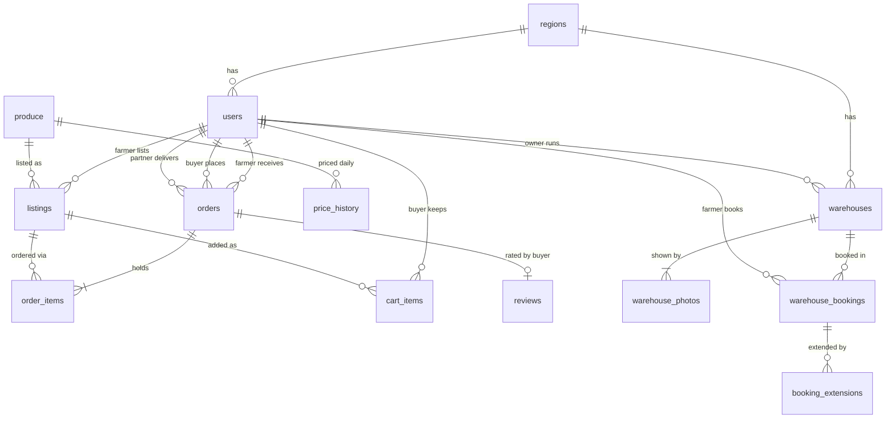

# AgriChain API

**From Farm to Market, Without Barriers.** This is the backend for a regional marketplace where farmers sell their daily organic produce directly to buyers and retailers, priced at the day's market rate, with no middlemen.

## Features
- **Phone + password auth (JWT)** with four roles: `FARMER`, `BUYER`, `WAREHOUSE_OWNER`, `DELIVERY_PARTNER`
- **Fair pricing:**
  - today's Kerala market rate for all 80 vegetables and fruits is fetched from vegetablemarketprice.com **every day at 6:00 am IST** (configurable) and stored in `price_history`
  - if the server was off at that time, missing prices are filled in when it starts; if the site is down, the last known price is used
  - farmers can set their own price, but only **within ±20% of the market rate**
  - buyers see how far each listing is from the market price
- **Regional marketplace:** buyers browse and order from farmers in their own region
- **Safe ordering:** stock is reserved inside a PostgreSQL transaction with row locks (`SELECT … FOR UPDATE`), so two buyers can never oversell a listing
- **Integrated delivery:**
  - lifecycle: `PENDING → CONFIRMED` (farmer) `→ OUT_FOR_DELIVERY` (partner picks up) `→ DELIVERED`; `CANCELLED` is only possible while pending, and returns the stock
  - delivery partners see confirmed orders in their region and claim them; a row lock ensures only one partner can claim an order
  - delivery fee = ₹20 + ₹2/kg, charged once per order
- **Shopping cart:** buyers collect produce in a cart stored in the database; checkout splits it into one order per farmer (a partner collects from one farmer), each holding all of that farmer's items
- **Ratings & reviews:** buyers rate the farmer (1–5) once an order is delivered; listings show the farmer's average rating
- **Role dashboards:** one endpoint returns the right stats for each role (earnings, 7-day revenue, top produce, spend, warehouse occupancy, delivery earnings)
- **Warehouse storage:**
  - owners list cold or dry storage with **2 to 5 photos** and a price per kg per day
  - a farmer picks dates and sends a **request**; the owner accepts or declines (a waiting request holds the space)
  - when the dates end the farmer **releases or extends** (the owner approves extensions); a booking left past its end date is **overdue**, keeps its space and keeps being charged daily
  - a warehouse can be paused or removed only while it has no waiting or approved bookings
- Input validation (zod), centralized error handling, rate-limited auth, Helmet and CORS
- Integration tests (Vitest + Supertest) against a real PostgreSQL test database

## Tech stack
Node.js · Express 5 · PostgreSQL (`pg`, plain SQL) · JWT · bcrypt · zod · Vitest · Supertest

## Project structure
```
src/
  app.js / server.js        Express app (importable by tests) / HTTP server
  config/env.js             Validated environment variables
  db/                       Connection pool, transaction helper, migrations, seed
  middleware/               auth (JWT + roles), validation, error handling
  modules/<feature>/        routes → controller → service (+ zod schemas)
    auth, regions, produce, listings, cart, orders, deliveries, reviews,
    dashboard, warehouses, bookings
scripts/                    db:migrate, db:seed, db:reset CLIs
tests/                      API integration tests
docs/api.http               Ready-to-run example requests
```

## Data model


## Getting started
Requires Node.js 20+ and PostgreSQL 14+.

```bash
npm install
cp .env.example .env          # then fill in DATABASE_URL and JWT_SECRET
npm run db:migrate            # create / upgrade tables
npm run db:seed               # regions, produce, demo users, sample listings
npm run dev                   # http://localhost:5000
```

| Script | What it does |
|---|---|
| `npm run dev` / `npm start` | Start the API (with / without auto-reload) |
| `npm run db:migrate` | Apply new files in `src/db/migrations` |
| `npm run db:seed` | Idempotent demo data |
| `npm run db:reset -- --yes` | **Drop everything**, then migrate and seed |
| `npm run prices:fetch` | Fetch today's market prices now (same as the daily job) |
| `npm test` | Run the tests against `TEST_DATABASE_URL` (wiped on each run) |
| `npm run lint` | ESLint |

### Demo accounts
Every seeded user has the password `AgriChain@123`.

| Role | Region | Phone |
|---|---|---|
| Farmer | Erumely | 9991110001 |
| Farmer | Kanjirapally | 9661439890 |
| Buyer | Erumely | 9791118801 |
| Buyer | Kanjirapally | 9456439760 |
| Warehouse owner | Erumely | 9771238800 |
| Delivery partner | Erumely | 9000011111 |
| Delivery partner | Kanjirapally | 9000022222 |

## API
Send `Authorization: Bearer <token>` (from register or login) on protected routes. Errors look like `{ "error": { "message": "...", "details": [...] } }`.

| Method | Path | Who | Description |
|---|---|---|---|
| POST | `/api/auth/register` | public | Create an account, returns `{ token, user }` |
| POST | `/api/auth/login` | public | `{ phone, password }` → `{ token, user }` |
| GET | `/api/auth/me` | any | Current user |
| POST | `/api/auth/refresh` | any | New 1-hour token for the same login; refused 12 hours after the original login |
| GET | `/api/regions` | public | All regions |
| GET | `/api/produce?category=` | public | Produce catalogue |
| GET | `/api/produce/prices` | public | Today's and yesterday's market price for every produce item |
| GET | `/api/produce/:id/price` | public | Today's market price |
| POST | `/api/produce` | farmer | `{ name, category }`: add your own produce type (no market price, so no ±20% band; at most 10 per farmer) |
| GET | `/api/listings?region_id=&category=&produce_id=&search=` | public | Browse active listings |
| GET | `/api/listings/:id` | public | One listing |
| GET | `/api/listings/mine` | farmer | My listings |
| POST | `/api/listings` | farmer | `{ produce_id, available_qty, listing_price? }`; price defaults to the market rate, and a custom one must be within ±20% |
| PATCH | `/api/listings/:id` | farmer (owner) | `{ available_qty?, listing_price?, is_active? }`; `is_active: true` puts a stopped listing back on sale |
| PATCH | `/api/listings/:id/deactivate` | farmer (owner) | Stop selling (hide from buyers) |
| DELETE | `/api/listings/:id` | farmer (owner) | Delete a listing; refused while it has open orders. Past orders keep their history |
| GET | `/api/cart` | buyer | My cart, grouped by farmer, with live prices, delivery fee per farmer and a `problem` flag on items that can't be ordered |
| POST | `/api/cart` | buyer | `{ listing_id, quantity }`; adding the same listing again adds up the quantity |
| PATCH | `/api/cart/items/:id` | buyer | `{ quantity }` |
| DELETE | `/api/cart/items/:id`, `/api/cart` | buyer | Remove one item / empty the cart |
| POST | `/api/cart/checkout` | buyer | `{ delivery_address? }`; one order per farmer, all or nothing; returns the new orders and empties the cart |
| POST | `/api/orders` | buyer | `{ items: [{ listing_id, quantity }], delivery_address? }`; like checkout without the cart; returns an array of orders |
| GET | `/api/orders/mine?status=` | buyer | My orders |
| GET | `/api/orders/incoming?status=` | farmer | Orders on my listings |
| PATCH | `/api/orders/:id/cancel` | buyer / farmer | Cancel or reject a pending order |
| PATCH | `/api/orders/:id/confirm` | farmer (owner) | PENDING → CONFIRMED |
| POST | `/api/orders/:id/review` | buyer (owner) | `{ rating 1–5, comment? }`, once, after delivery |
| GET | `/api/deliveries/available` | partner | Confirmed, unclaimed orders in my region |
| GET | `/api/deliveries/mine?status=` | partner | My deliveries |
| PATCH | `/api/deliveries/:orderId/accept` | partner | CONFIRMED → OUT_FOR_DELIVERY |
| PATCH | `/api/deliveries/:orderId/complete` | partner (assigned) | OUT_FOR_DELIVERY → DELIVERED |
| PATCH | `/api/deliveries/:orderId/delay` | partner (assigned) | Report a delay `{ reason, minutes }`; buyer and farmer see it |
| PATCH | `/api/deliveries/:orderId/release` | partner (assigned) | Give the delivery back: OUT_FOR_DELIVERY → CONFIRMED, available again |
| GET | `/api/reviews?farmer_id=` | public | A farmer's reviews |
| GET | `/api/reviews/partners?partner_id=`, `/api/reviews/warehouses?warehouse_id=` | public | A delivery partner's / warehouse's reviews |
| POST | `/api/orders/:id/partner-review` | buyer (owner) | Rate the delivery partner `{ rating 1–5, comment? }`, once, after delivery |
| POST | `/api/warehouse-bookings/:id/review` | farmer (owner) | Rate a warehouse after taking the produce out, once |
| PATCH | `/api/auth/me` | any | Change name and place (phone and area are fixed) |
| POST | `/api/auth/change-password` | any | `{ current_password, new_password }`; returns a fresh login |
| POST | `/api/auth/forgot-password` | public | `{ phone }`: sends a one-time code (printed in the server console; also returned as `dev_code` when `RESET_CODE_IN_RESPONSE` is on) |
| POST | `/api/auth/reset-password` | public | `{ phone, code, new_password }`; the code works once, 5 tries |
| GET | `/api/notifications?limit=` | any | My notifications with `unread_count` |
| PATCH | `/api/notifications/:id/read`, POST `/api/notifications/read-all` | any | Mark read |
| GET | `/api/dashboard` | any | Stats for the logged-in user's role |
| GET | `/api/warehouses?region_id=&cold_storage=` | public | Browse warehouses (cheapest first) |
| GET | `/api/warehouses/:id` | public | One warehouse (with photos, space free today, open bookings) |
| GET | `/api/warehouses/:id/availability?from=&to=` | any | Kilograms free on every day of the range |
| GET | `/api/warehouses/mine` | owner | My warehouses |
| POST | `/api/warehouses` | owner | Create a warehouse in my region: `multipart/form-data` with the fields and **2 to 5 photos** (JPEG, PNG or WebP, 5 MB each) |
| PATCH | `/api/warehouses/:id` | owner | Change name, place, space (never below what is booked), price, cold flag, `is_active` (pausing needs no open bookings) |
| DELETE | `/api/warehouses/:id` | owner | Remove (soft delete); refused while it has waiting or approved bookings |
| POST | `/api/warehouses/:id/photos` | owner | Add photos (at most 5 in total) |
| DELETE | `/api/warehouses/:id/photos/:photoId` | owner | Remove a photo (at least 2 stay) |
| POST | `/api/warehouse-bookings` | farmer | `{ warehouse_id, quantity_kg, produce_id?, start_date?, end_date? }`: a **request** the owner must accept; holds the space meanwhile |
| GET | `/api/warehouse-bookings/mine` | farmer | My bookings (with `is_overdue`, live `amount_to_pay` and the latest `extension`) |
| GET | `/api/warehouse-bookings/incoming` | owner | Bookings at my warehouses |
| PATCH | `/api/warehouse-bookings/:id/approve` | owner | Accept a request |
| PATCH | `/api/warehouse-bookings/:id/reject` | owner | Decline a request, `{ note? }` |
| PATCH | `/api/warehouse-bookings/:id/cancel` | farmer | Withdraw a request, or an approved booking that has not started |
| PATCH | `/api/warehouse-bookings/:id/release` | farmer | Take the produce out; pays for the days used (overdue days included) |
| POST | `/api/warehouse-bookings/:id/extend` | farmer | `{ new_end_date }`: asks the owner to extend |
| PATCH | `/api/warehouse-bookings/:id/extension/approve`, `/reject` | owner | Answer an extension request |
| PATCH | `/api/warehouse-bookings/:id/extension/cancel` | farmer | Withdraw an extension request |
| GET | `/health` | public | API + database status |

See [`docs/api.http`](docs/api.http) for runnable examples (VS Code REST Client / JetBrains HTTP client).
